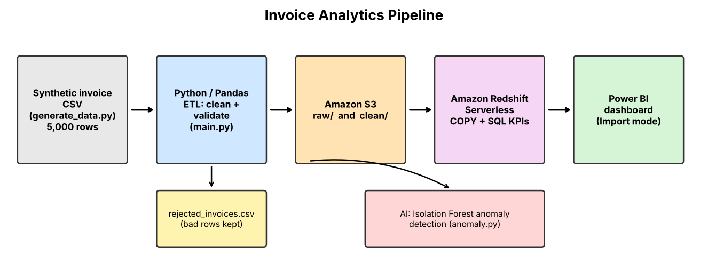
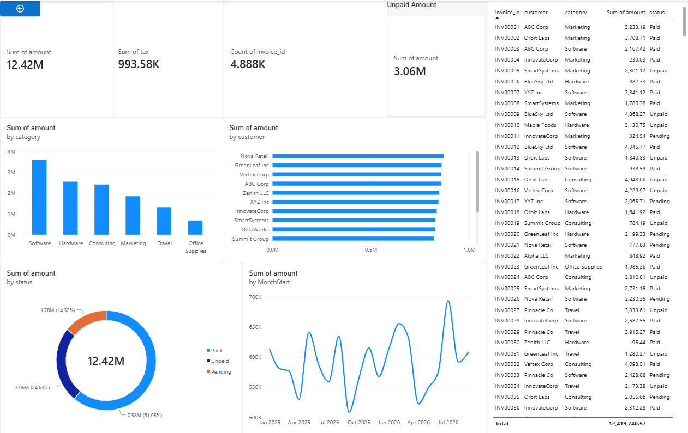
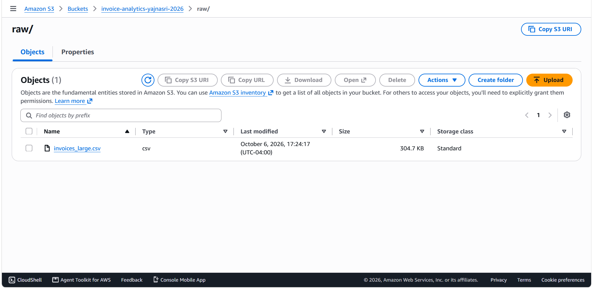
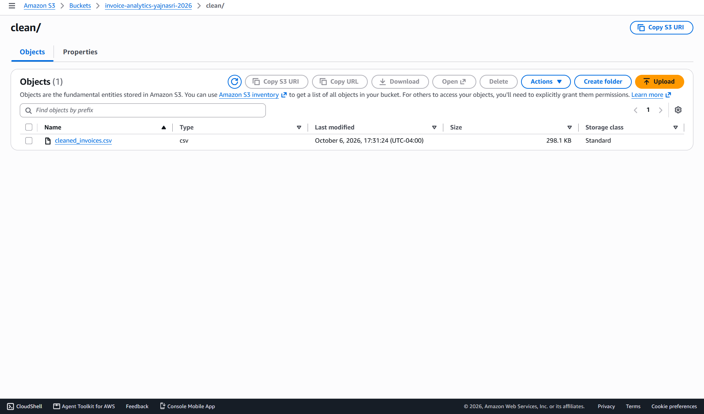
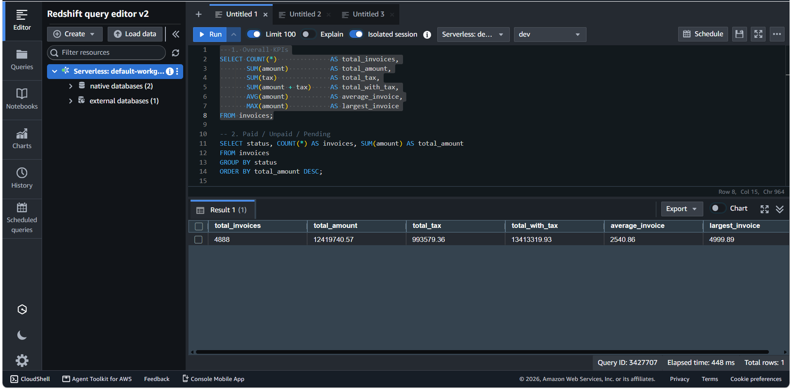

# Invoice Analytics Pipeline

An end-to-end data engineering project: raw invoice data is cleaned with Python/Pandas, stored in AWS S3, loaded into Amazon Redshift, analysed with SQL, shown in a Power BI dashboard, and checked for unusual invoices with a machine-learning model.

> **Data note:** all data is synthetic, generated by `generate_data.py`. No real company or customer data is used.

## Architecture



`generate_data.py` -> `main.py` (clean + validate) -> S3 (`raw/`, `clean/`) -> Redshift (`COPY` + SQL KPIs) -> Power BI dashboard
and `anomaly.py` (Isolation Forest) on the cleaned data.

## Business questions answered

| Question | Where |
|---|---|
| Total invoice value, total tax, invoice count, average invoice | `sql/kpis.sql`, dashboard cards |
| How many invoices are Paid / Unpaid / Pending, and how much is unpaid? | status breakdown, donut chart |
| Which customers have the highest invoice value? | top customers chart |
| Which spend categories cost the most? | category chart (click a bar to see its invoices) |
| How do invoice amounts change over time? | monthly line chart |
| Which invoices look unusual? | `anomaly.py` -> `data/flagged_invoices.csv` |

## Results (synthetic data)

- 5,000 raw invoices -> **4,888 clean**, 112 rejected (bad status format, missing amount, invalid date, duplicate id), saved to `data/rejected_invoices.csv`
- Total invoice amount: **12,419,740.57**; total tax about 993.6K (8%)
- Unpaid: about **3.06M** (24.6%); Paid about 7.58M (61.1%); Pending about 1.78M (14.3%)
- The same totals were checked in Pandas, SQLite and Redshift and they match.

## Screenshots

| | |
|---|---|
| Dashboard |  |
| S3 raw folder |  |
| S3 clean folder |  |
| Redshift KPI query |  |

## Tech stack and why

- **Python / Pandas**: cleaning, validation, rejected-row tracking
- **SQLite**: quick local SQL practice on the same data (`sql_demo.py`)
- **Amazon S3**: raw and clean data storage (data lake layer)
- **Amazon Redshift Serverless**: warehouse; loaded with `COPY` from S3 (`sql/schema.sql`)
- **SQL**: KPI queries (`sql/kpis.sql`)
- **Power BI**: dashboard with drill-down from category to invoice
- **scikit-learn (Isolation Forest)**: flags unusually large or small invoices for review

## Project structure

```
invoice_analytics_project/
├── main.py              # clean + validate, write cleaned/rejected CSVs
├── generate_data.py     # creates synthetic invoices
├── sql_demo.py          # SQLite KPI demo
├── anomaly.py           # Isolation Forest anomaly detection
├── sql/
│   ├── schema.sql       # Redshift table + COPY from S3
│   └── kpis.sql         # KPI queries
├── data/                # raw, cleaned, rejected and flagged CSVs
├── dashboard/           # Power BI file
├── docs/                # architecture diagram + screenshots
└── requirements.txt
```

## How to run locally

```
pip install -r requirements.txt
python generate_data.py
python main.py
python sql_demo.py
python anomaly.py
```

The S3, Redshift and Power BI parts need your own AWS account (see `sql/schema.sql`).

## Limitations and honest notes

- The Power BI report uses **Import mode**, so it is a copy of the data, not a live connection.
- The Redshift warehouse was deleted after the project to avoid cost, so the dashboard cannot refresh. The queries in `sql/` can be re-run on a new warehouse.
- The data is random, so the anomaly model flags statistical extremes, not real errors. In a test where 10 invoices were inflated 10x, it caught 9 of 10.
- AWS steps (S3, IAM role, Redshift) were done manually in the console, not with infrastructure-as-code.

## Possible next steps

- Automate the pipeline with a scheduler (for example Airflow) and infrastructure as code (Terraform)
- Add a PySpark version for larger volumes
- Add unit tests for the cleaning rules
